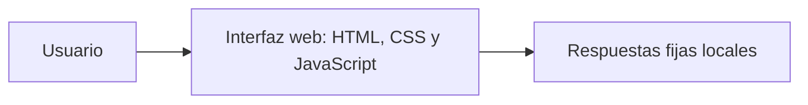
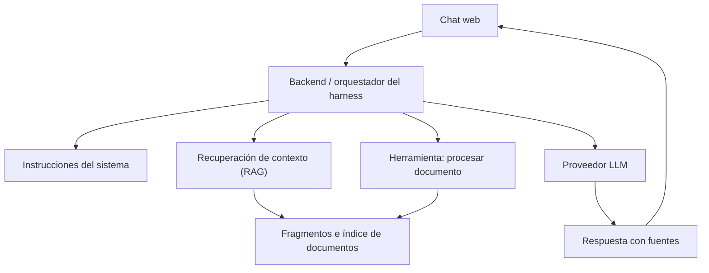

# Arquitectura inicial

## Implementado en el primer avance

Vite sirve el proyecto durante el desarrollo y genera los archivos estáticos. La conversación solo vive en memoria: recargar la página o iniciar una nueva conversación elimina los mensajes. No hay peticiones a proveedores de IA, almacenamiento de documentos ni credenciales.

Se utiliza JavaScript sin framework para mantener pequeño el primer incremento. La interfaz y sus estados podrán conectarse a un backend en un cambio posterior.

## Arquitectura prevista, todavía no implementada

El backend controlará el flujo: validar entrada, recuperar contexto, construir mensajes, invocar al modelo y devolver la respuesta con fuentes. Las herramientas tendrán contratos de entrada y salida y validaciones del lado del servidor.

### RAG y herramientas tienen responsabilidades diferentes

- **RAG:** encontrar fragmentos relevantes del material ya incorporado y añadirlos como contexto.
- **Herramienta de procesamiento:** aceptar un archivo permitido, extraer texto y devolver un resultado estructurado para su incorporación. La extracción en sí no constituye RAG.

### Decisiones reservadas para próximos cambios

- Proveedor del modelo y límites de consumo.
- Backend, almacenamiento, estrategia de fragmentación e índice de recuperación.
- Contrato de carga de archivos, tamaño permitido y manejo de errores.
- Hosting del frontend y del backend.

Las claves del proveedor vivirán en el servidor. Los documentos se tratarán como datos: su contenido no podrá cambiar las instrucciones del sistema ni autorizar herramientas. Los límites se implementarán también en código, no únicamente en el prompt.
