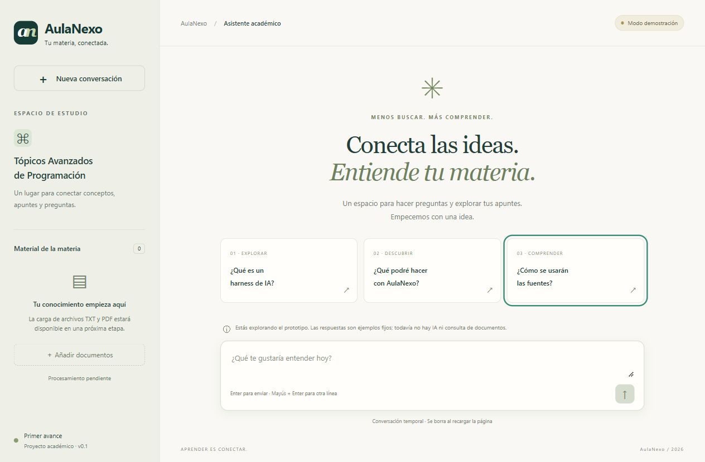

# Primer avance: AulaNexo

**Materia:** Tópicos Avanzados de Programación  
**Modalidad elegida:** opción 3, harness web especializado  
**Metodología:** desarrollo guiado por especificaciones (SDD) con OpenSpec

## Problema y objetivo

Consultar apuntes distribuidos entre varios documentos requiere búsquedas manuales y dificulta localizar la fuente de una explicación. El objetivo es construir un asistente web para consultar material de la materia y recibir respuestas vinculadas a los fragmentos utilizados.

## Por qué es un harness

La aplicación coordinará las reglas del modelo, la recuperación de contexto y la ejecución de herramientas desde un backend. El modelo será un componente de esa arquitectura. La interfaz permitirá consultar el material y revisar las fuentes.

## Qué incluye este avance

- Repositorio y estructura inicial reproducible con npm.
- Propuesta, diseño, requisitos verificables y tareas en OpenSpec, escritos antes de la interfaz.
- Pantalla de chat adaptable a escritorio y móvil.
- Envío local de mensajes y respuestas fijas de demostración.
- Borrador de instrucciones del sistema y arquitectura prevista.

El prototipo no ejecuta inteligencia artificial ni procesa archivos. El indicador «Modo demostración» y los mensajes de la interfaz explican esa limitación.

## Alcance de la primera versión funcional

1. Consultar documentos de una sola materia.
2. Incorporar inicialmente TXT y después PDF con texto seleccionable.
3. Recuperar fragmentos pertinentes y responder citando su procedencia.
4. Informar cuando el material disponible no permita responder.
5. Publicar el frontend y el backend para acceder desde un navegador.

Por ahora quedan fuera: múltiples materias, usuarios y permisos, OCR de documentos escaneados, evaluación automática y ejecución de código del usuario.

## Demostración sugerida para la exposición

1. Explicar el problema, la opción elegida y los componentes del harness.
2. Mostrar el cambio inicial en `openspec/changes/` o su archivo histórico: propuesta → especificaciones → diseño → tareas.
3. Ejecutar `npm run dev` y abrir la interfaz.
4. Seleccionar una pregunta sugerida y señalar que la respuesta es una demostración.
5. Enviar texto propio, reiniciar el chat y mostrar que los documentos todavía no están habilitados.
6. Presentar como siguiente paso la ingestión de un TXT y la recuperación de fragmentos.

## Criterios de aceptación del avance

La aplicación debe identificar su estado de demostración, aceptar consultas no vacías sin ejecutar su contenido como HTML, mostrar respuestas fijas sin atribuirlas a un LLM y permitir limpiar la conversación. La compilación y la validación estricta de OpenSpec deben finalizar correctamente.

## Verificación realizada

- Compilación de producción y validación estricta de OpenSpec correctas.
- Comprobadas las tres sugerencias y una consulta propia.
- Comprobados el rechazo de espacios y de 1001 caracteres y el reinicio de la conversación.
- El texto `<b>Consulta propia</b>` se muestra literalmente, sin crear elementos HTML.
- Comprobados el salto de línea con Mayús + Enter y el foco visible con teclado.
- Vista móvil de 360 × 800 sin desplazamiento horizontal de la página.
- Sin advertencias ni errores capturados en la consola del navegador durante la revisión.

